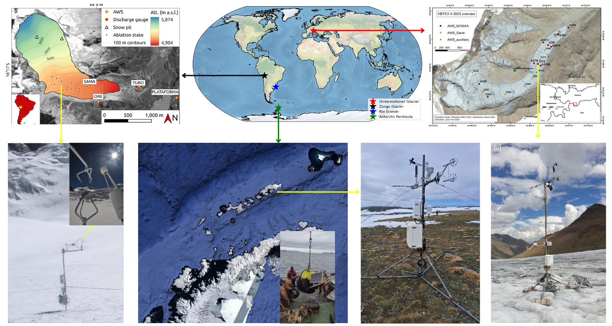

# CRYOEXTREMES Practical Workflows: Surface Energy Balance & Air-Sea/Ice Fluxes

This repository contains practical exercise material and workflows for analyzing the **Surface Energy Balance (SEB)** and turbulent heat fluxes using Eddy Covariance (EC) tower and oceanic/estuarine buoy measurements. 



During the course, participants work with real-world low- and high-frequency data collected in the Antarctic Peninsula (Penguin Island tower and Bransfield Strait buoy measurements) during the Antarctic Modeling Observation System (ATMOS2) Project, at the Hintereisferner glacier (Austria) during the Second Hintereisferner Experiment (HEFEX II), at the Zongo Glacier (Bolivia), and at the Patos Lagoon estuary. Full information regarding the HEFEX II experiment can be found in Nicholson et al. (2025).

> **Course Reference**: This material forms part of the practical modules for the **CRYOEXTREMES** course. For full details and lecture slides, visit the official site: [CRYOEXTREMES Course](https://cryohydromettools.github.io/CRYOEXTREMES.github.io/).

---

## 📚 Notebook Structure & Workflow

The analysis is structured sequentially across the practical Jupyter Notebooks:

### 0. Study Site Mapping & Localization (`0_map_loc.ipynb`)
- Generates a global Robinson projection map to visualize and highlight the key study sites and monitoring stations.

### 1. Low-Frequency Data Preprocessing (`1_join_data_low_freq.ipynb`)
- Reads, parses, and cleans low-frequency meteorological time series from the Penguin Island site.
- Configures datetime indexing, performs quality control, and handles missing data.
- Standardizes shortwave ($SW_{in}, SW_{out}$) and longwave ($LW_{in}, LW_{out}$) radiation components into structured Pandas DataFrames.

### 2. Tower Surface Energy Balance Analysis (`2_0_seb_tower.ipynb`, `2_1_seb_tower_biomet.ipynb`, `2_2_comp_basic_biomet.ipynb`)
- Merges processed low-frequency meteorological observations with high-frequency Eddy Covariance (EC) tower flux measurements.
- Calculates Net Radiation ($R_n$), Sensible Heat Flux ($H$), Latent Heat Flux ($LE$), and the Energy Balance Residual.
- Includes biomet observations and basic comparisons for Penguin Island station data.

### 3. Oceanic Buoy & COARE Bulk Flux Modeling (`3_bulk_buoy.ipynb`)
- Processes oceanic buoy observational data ($T_2$, $SST$, relative humidity, and wind speed) from the Bransfield Strait.
- Executes the **COARE 3.5 bulk algorithm** (`coare35vn.py`, `meteo.py`, `util.py`) to estimate air-sea sensible ($H$) and latent ($LE$) heat fluxes.
- Generates diagnostic multi-panel figures comparing forcing variables and bulk fluxes.

### 4. Comparative Tower & Buoy Analysis (`4_comp_tower_bouy.ipynb`, `4_comp_tower_bouy_biomet.ipynb`)
- Cross-compares simultaneous micrometeorological and turbulent flux observations between land-based tower systems and marine/aquatic buoy deployments across the Antarctic Peninsula region.

### 5. Hintereisferner (HEF) Glacier SEB Analysis (`5_HEF_glacier.ipynb`)
- Analyzes high-resolution surface meteorological and Eddy Covariance flux data collected directly on the **Hintereisferner Glacier (HEF)** during HEFEX II.
- Computes Net Radiation ($R_n$) and evaluates ice/snow surface energy balance closure ($R_n - H - LE$).

### 6. Zongo Glacier SEB Analysis (`6_Zongo_glacier.ipynb`)
- Analyzes high-resolution surface meteorological and turbulent flux observations collected at the **Zongo Glacier** monitoring site.
- Implements timestamp alignment, net radiation calculation, and surface energy balance closure visualization.

### 7. Patos Lagoon Estuary Buoy Analysis (`7_Patos_Lagoon_estuary_bouy.ipynb`)
- Processes and analyzes estuarine buoy measurements from the **Patos Lagoon** system to evaluate surface forcing and aquatic-atmospheric exchanges.

---

## 🚀 Running on Google Colab

These notebooks are designed to be run directly in **Google Colab** (with optional Google Drive mounting code blocks provided in the setup sections). 

If additional packages are required within a session, you can install them at the beginning of the notebook.

---

## 📂 Repository Structure

```text
.
├── 0_map_loc.ipynb                    # 0. Study site mapping & localization
├── 1_join_data_low_freq.ipynb         # 1. Low-frequency data preprocessing
├── 2_0_seb_tower.ipynb                # 2. Tower SEB analysis & flux calculation
├── 2_1_seb_tower_biomet.ipynb         # 2. Tower biomet analysis
├── 2_2_comp_basic_biomet.ipynb        # 2. Comparative basic biomet analysis
├── 3_bulk_buoy.ipynb                  # 3. Bransfield Strait buoy data & COARE 3.5 flux modeling
├── 4_comp_tower_bouy.ipynb            # 4. Comparative tower vs. buoy analysis
├── 4_comp_tower_bouy_biomet.ipynb     # 4. Comparative tower vs. buoy analysis with biomet
├── 5_HEF_glacier.ipynb                # 5. HEF Glacier SEB analysis
├── 6_Zongo_glacier.ipynb              # 6. Zongo Glacier SEB analysis
├── 7_Patos_Lagoon_estuary_bouy.ipynb  # 7. Patos Lagoon estuary buoy analysis
├── coare35vn.py                       # COARE 3.5 bulk algorithm script
├── meteo.py                           # Thermodynamic utilities for COARE
├── util.py                            # Helper functions for bulk flux calculations
├── img/                               # Course images (contains fig_course_furg.png)
├── data/                              # Raw and processed datasets (ignored by Git)
├── fig/                               # Output figures and exported plots
├── .gitignore                         # Git ignore file for local data/cache
└── README.md                          # Project documentation

 ```


---


## 📖 References


**Nicholson, L., Stiperski, I., Nitti, G., Prinz, R., Georgi, A., Groos, A. R., et al. (2025).** The Second Hintereisferner Experiment (HEFEX II): Initial Insights into Boundary Layer Structure and Surface–Atmosphere Exchange Processes from Intensive Observations at a Valley Glacier. *Bulletin of the American Meteorological Society*, 106(10), E2143–E2169. https://doi.org/10.1175/BAMS-D-24-0010.1 